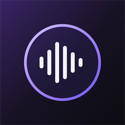
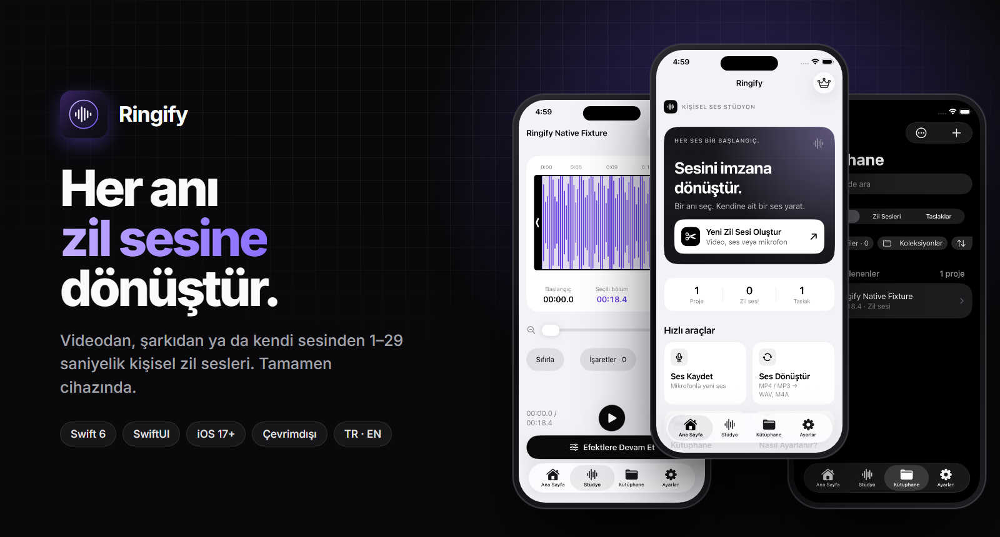
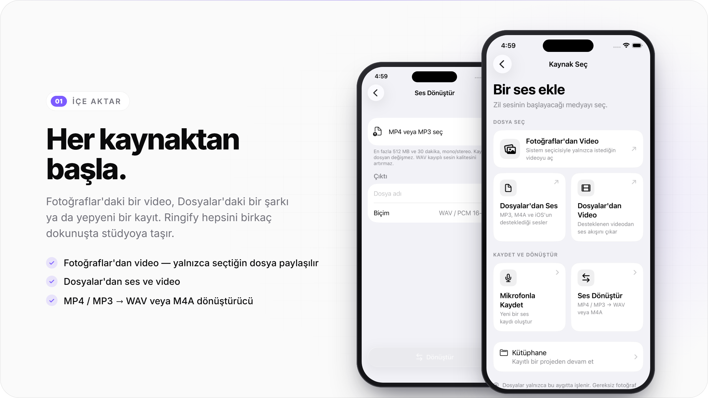
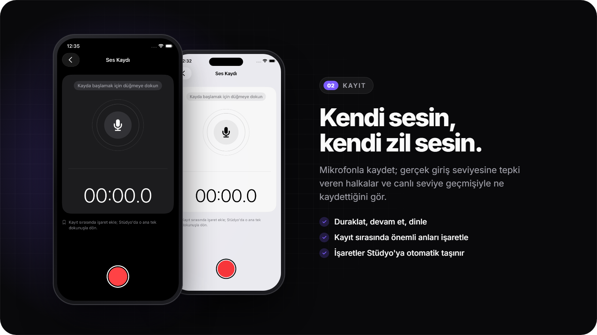
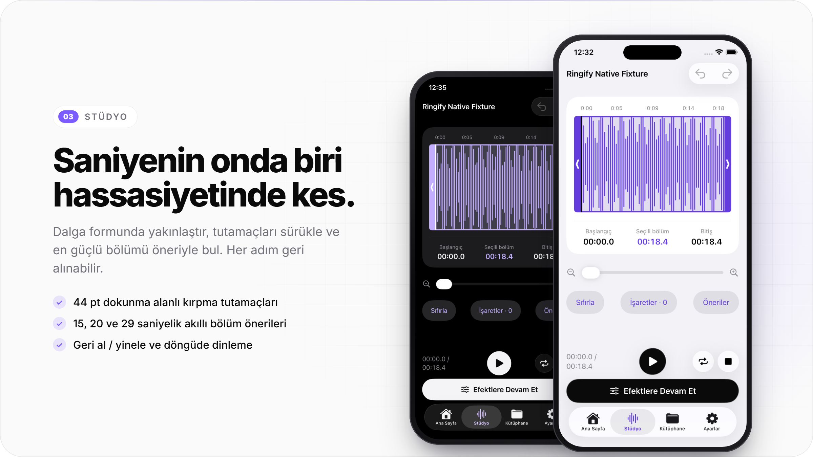
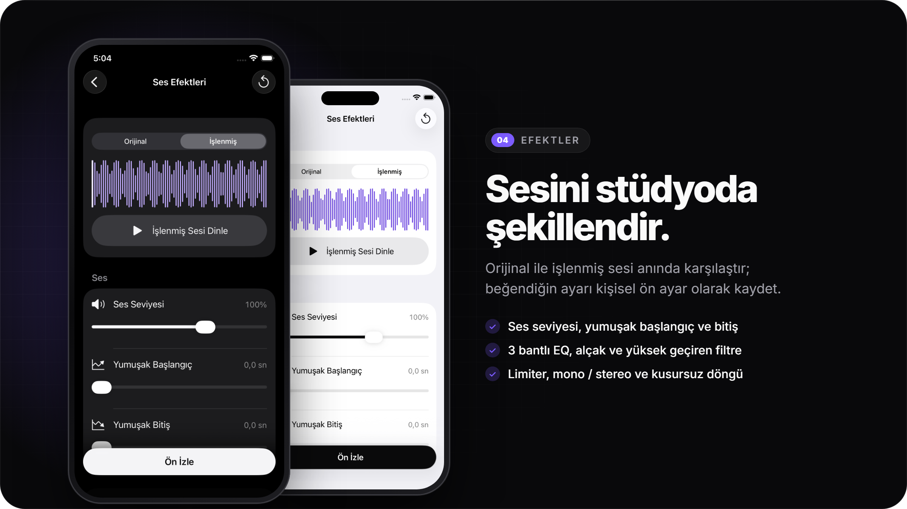
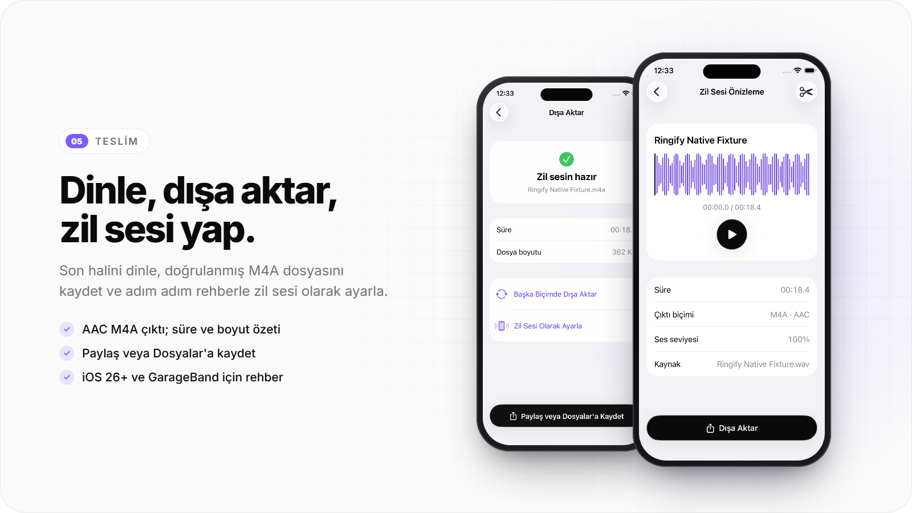
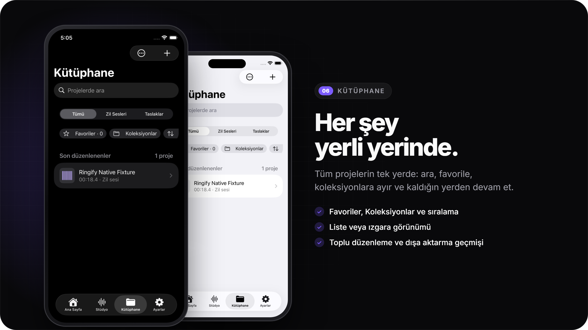
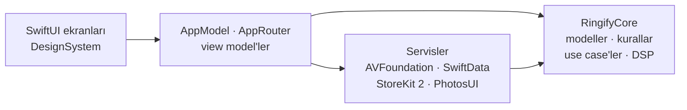

<div align="center">



# Ringify

**Her anı zil sesine dönüştür.**

<br>



<br>
<br>

Bir videodan, şarkıdan ya da kendi sesinden 1–29 saniyelik kişisel iPhone zil sesleri oluşturan,<br>
tamamen cihaz üzerinde çalışan, çevrimdışı öncelikli bir ses stüdyosu.

<br>


**[Ekranlar](#ekranlar)** &nbsp;·&nbsp; **[Mimari](#mimari)** &nbsp;·&nbsp; **[Testler](#testler)** &nbsp;·&nbsp; **[Gizlilik](#gizlilik)** &nbsp;·&nbsp; **[Yol haritası](#yol-haritası)**

</div>

<br>

<table>
  <tr>
    <td width="50%" valign="top">
      <h4>🔒&nbsp; Tamamen cihazında</h4>
      Hesap, sunucu ya da izleme yok. Ses işleme baştan sona iPhone'da yapılır.
    </td>
    <td width="50%" valign="top">
      <h4>🎚️&nbsp; Gerçek bir ses stüdyosu</h4>
      Hassas kesim, EQ, filtreler, limiter, kusursuz döngü ve önce/sonra karşılaştırması.
    </td>
  </tr>
  <tr>
    <td width="50%" valign="top">
      <h4>⚡&nbsp; Saniyeler içinde hazır</h4>
      İçe aktar, kes, dinle, dışa aktar; zil sesi olarak ayarlamak için adım adım rehber.
    </td>
    <td width="50%" valign="top">
      <h4>🍎&nbsp; Apple'a özgü tasarım</h4>
      SwiftUI, SF Symbols, Dynamic Type, VoiceOver ve iOS 26 Liquid Glass (iOS 17 uyumlu).
    </td>
  </tr>
</table>

<br>

## Ekranlar

<p align="center"></p>
<p align="center"></p>
<p align="center"></p>
<p align="center"></p>
<p align="center"></p>
<p align="center"></p>

<p align="center"><sub>Telefon ekranları, uygulamanın CI üzerinde iPhone Simulator'dan alınmış gerçek açık ve koyu tema görüntüleridir.</sub></p>

<details>
<summary><b>Tüm özellikler</b></summary>
<br>

| Alan | Özellikler |
| :-- | :-- |
| **İçe aktarma** | Fotoğraflar'dan video (sistem seçicisi, tam fotoğraf erişimi yok) · Dosyalar'dan ses ve video · MP4 / MP3 → WAV veya M4A dönüştürücü (512 MB / 30 dk'ya kadar, kaynak değişmez) |
| **Kayıt** | Canlı seviye geçmişi · seviyeye tepki veren mikrofon halkaları · duraklat / devam et · kayıt sırasında işaret ekleme |
| **Stüdyo** | 1–29 sn seçim · 44 pt kırpma tutamaçları · yakınlaştırma · geri al / yinele · döngüde dinleme · işaretler · 15 / 20 / 29 sn akıllı öneriler |
| **Efektler** | Ses seviyesi · yumuşak başlangıç ve bitiş · 3 bantlı EQ · alçak / yüksek geçiren filtre · mono / stereo · limiter · kusursuz döngü geçişi · önce/sonra karşılaştırma · sinyal analizi · kişisel ön ayarlar |
| **Teslim** | Doğrulanmış AAC M4A çıktı · Paylaş / Dosyalar'a kaydet · iOS 26+ ve GarageBand zil sesi rehberi |
| **Kütüphane** | Arama · Favoriler · Koleksiyonlar · sıralama · liste / ızgara · toplu düzenleme · dışa aktarma geçmişi |
| **Ringify Pro** | StoreKit 2 ile haftalık, aylık, yıllık ve ömür boyu planlar · ek proje yuvaları |
| **Erişilebilirlik** | Açık / Koyu tema · Dynamic Type · VoiceOver etiket ve eylemleri · Hareketi Azalt · Türkçe ve İngilizce |

</details>

<br>

## Mimari

Platform kodu ile ürün kuralları birbirinden ayrıdır. Uygulama hedefi arayüzü ve sistem çerçevelerini yönetir; **`RingifyCore`** Swift paketi alan mantığını taşır ve simülatör olmadan macOS'ta derlenip test edilir.



| Katman | Sorumluluk |
| :-- | :-- |
| **Screens · DesignSystem** | SwiftUI ekranları; `RingifyPrimaryButton`, `RingifyRow`, çerçeveli kartlar gibi ortak bileşenler; semantik renkler ve tasarım tokenları |
| **App** | `AppModel` durumu, `AppRouter` gezinmesi, bağımlılık kabı |
| **Services** | Medya içe aktarma, dalga formu, kesim, efekt işleme, AAC dışa aktarma, dönüştürme, kayıt, oynatma, SwiftData kalıcılığı, satın alma |
| **RingifyCore** | Zil sesi kuralları, düzenleyici geçmişi, kazanç zarfı, döngü geçişi, bölüm önerileri, sinyal analizi, kütüphane modelleri, Pro erişim politikası |

Tüm hedeflerde Swift 6 dil modu ve **tam katı eşzamanlılık** (strict concurrency) açıktır.

<details>
<summary><b>Teknoloji yığını</b></summary>
<br>

| Alan | Teknoloji |
| :-- | :-- |
| Dil | Swift 6 |
| Arayüz | SwiftUI, SF Symbols, Liquid Glass (iOS 26) |
| Ses | AVFoundation, AVAudioEngine, AVAssetExportSession |
| Kalıcılık | SwiftData, sandbox içindeki uygulama klasörleri |
| Satın alma | StoreKit 2, yerel `.storekit` yapılandırması |
| Proje | XcodeGen (`ios/project.yml`) |
| Test | XCTest: birim, entegrasyon, arayüz |
| CI | macOS üzerinde GitHub Actions |
| Web önizleme | React, TypeScript, Vite, Vitest |

</details>

<details>
<summary><b>Proje yapısı</b></summary>
<br>

```text
.
├── ios/
│   ├── project.yml             # XcodeGen proje tanımı
│   ├── Ringify/
│   │   ├── App/                # giriş noktası, AppModel, gezinme
│   │   ├── Screens/            # özellik ekranları
│   │   ├── DesignSystem/       # tema, bileşenler, düzenleyici kuralları
│   │   ├── ViewModels/         # özellik view model'leri
│   │   ├── Services/           # AVFoundation, SwiftData, StoreKit
│   │   └── Resources/          # varlıklar, çeviriler, StoreKit yapılandırması
│   ├── RingifyTests/           # birim ve entegrasyon testleri
│   └── RingifyUITests/         # uçtan uca arayüz akışı ve ekran görüntüleri
├── packages/RingifyCore/       # platformdan bağımsız alan paketi
├── preview/                    # Windows için React etkileşimli önizleme
├── shared/                     # uygulama ve önizlemenin ortak ürün kataloğu
├── design/                     # tasarım tokenları ve marka kaynağı
├── scripts/                    # CI ve doğrulama yardımcıları
└── .github/workflows/          # manuel macOS doğrulama hatları
```

</details>

<br>

## Testler

| Paket | Kapsam |
| :-- | :-- |
| `RingifyCoreTests` | Zil sesi kuralları, düzenleyici geçmişi, DSP hesapları, bölüm önerileri, analiz eşlik fixture'ları |
| `RingifyTests` | Gerçek sesle servisler (MP3, AAC, MP4 → WAV / M4A), SwiftData disk ve göç, StoreKit test oturumları, sunum ve kontrast kontrolleri |
| `RingifyUITests` | Tanıtımdan dışa aktarmaya tam kullanıcı yolculuğu; her ekranı açık ve koyu temada yakalar |
| `preview` | Vitest ile önizleme arayüzü, ses işleme, dışa aktarma planı ve Pro kuralları |

Son macOS doğrulamasında Release derlemesi, **136 / 136** birim testi ve uçtan uca arayüz akışı başarıyla geçti.

<br>

## Tasarım ilkeleri

| İlke | Uygulama |
| :-- | :-- |
| **Sistemle uyumlu** | Gruplanmış sistem arka planları ve semantik renkler; Açık, Koyu ve Yüksek Kontrast ek palet gerektirmez |
| **Tek renkli ana eylemler** | Açık temada siyah, koyu temada beyaz; mor yalnızca bağlantı, seçim, dalga formu ve etkin sekmede |
| **Erişilebilir dokunma** | Ana eylemler alttaki sabit çubukta; her kontrol en az 44 pt |

Tasarım sözleşmesinin tamamı: [`docs/NATIVE_APPLE_DESIGN.md`](docs/NATIVE_APPLE_DESIGN.md)

<br>

## Gizlilik

- Tüm ses işleme cihazda yapılır; hesap, analitik veya izleme yoktur.
- Fotoğraflar erişimi sistem seçicisinden geçer; uygulama yalnızca seçilen videoyu görür.
- Uygulama bir gizlilik manifesti (`PrivacyInfo.xcprivacy`) ile gelir.

<br>

## Yol haritası

- [x] Native SwiftUI uygulaması ve `RingifyCore` alan paketi
- [x] Apple HIG yeniden tasarımı, açık ve koyu tema
- [x] macOS CI: Release derlemesi, 136 birim testi, uçtan uca arayüz akışı
- [ ] Fiziksel iPhone ve VoiceOver kabul testi
- [ ] TestFlight dağıtımı ve StoreKit sandbox satın alma testi
- [ ] App Store yayını

<br>

<div align="center">
<sub>© 2026 Ringify · Tüm hakları saklıdır.</sub>
</div>
