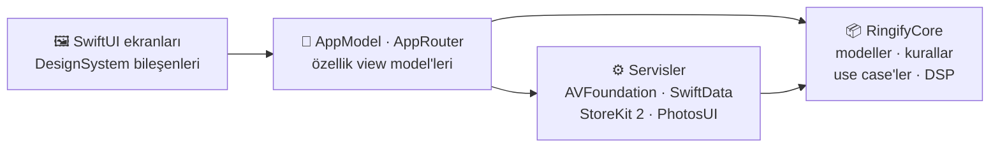

<div align="center">


<br>
<br>

# Ringify

### Her anı zil sesine dönüştür.

Bir videodan, şarkıdan ya da kendi sesinden 1–29 saniyelik kişisel iPhone zil sesleri oluşturan,<br>
tamamen cihaz üzerinde çalışan, çevrimdışı öncelikli bir ses stüdyosu.

<br>


[Özellikler](#-özellikler) · [Ekranlar](#-ekranlar) · [Mimari](#-mimari) · [Başlarken](#-başlarken) · [Test ve CI](#-test-ve-ci) · [Yol haritası](#-yol-haritası)

</div>

<br>

## ✦ Neden Ringify?

| | |
| :-- | :-- |
| **🔒 Tamamen cihazında** | Hesap yok, sunucu yok, izleme yok. Ses işleme baştan sona iPhone'da yapılır. |
| **🎚️ Gerçek bir ses stüdyosu** | Hassas kesim, EQ, filtreler, limiter, kusursuz döngü geçişi ve önce/sonra karşılaştırması. |
| **⚡ Saniyeler içinde hazır** | İçe aktar, kes, dinle, dışa aktar. Zil sesi olarak ayarlamak için adım adım rehber. |
| **🍎 Apple'a özgü tasarım** | SwiftUI, SF Symbols, Dynamic Type, VoiceOver ve iOS 26 Liquid Glass (iOS 17 geri dönüşlü). |

## ✦ Ekranlar

<table>
  <tr>
    <td width="33%"></td>
    <td width="33%"></td>
    <td width="33%"></td>
  </tr>
  <tr>
    <td width="33%"></td>
    <td width="33%"></td>
    <td width="33%"></td>
  </tr>
</table>

<sub>Görsellerdeki telefon ekranları, uygulamanın CI'da iPhone Simulator'dan alınmış gerçek ekranlarıdır.</sub>

## ✦ Özellikler

<table>
<tr>
<td width="50%" valign="top">

#### 📥 Yakalama
- **Her kaynaktan içe aktarma:** Fotoğraflar'dan video (yalnızca seçilen video paylaşılır), Dosyalar'dan ses ve video.
- **Ses kaydı:** canlı seviye geçmişi, duraklat/devam et ve kayıt sırasında eklenen işaretler.
- **Ses dönüştürücü:** MP4 / MP3 → WAV veya M4A; 512 MB ve 30 dakikaya kadar, kaynak dosya değişmez.

</td>
<td width="50%" valign="top">

#### ✂️ Düzenleme
- **Dalga formu stüdyosu:** 44 pt dokunma alanlı kırpma tutamaçları, yakınlaştırma, geri al / yinele, döngüde dinleme.
- **İşaretler ve akıllı öneriler:** kayıtlı anlara atla ya da en güçlü 15, 20 ve 29 saniyelik bölümleri öneriyle bul.
- **Kişisel ayarlar:** sevdiğin sesi kaydet, sonraki projeye tek dokunuşla uygula.

</td>
</tr>
<tr>
<td width="50%" valign="top">

#### 🎛️ Efektler ve analiz
- Ses seviyesi, yumuşak başlangıç ve bitiş.
- 3 bantlı EQ, alçak ve yüksek geçiren filtreler.
- Mono / stereo, limiter ve kusursuz döngü geçişi.
- Orijinal ile işlenmiş sesin önce/sonra karşılaştırması ve sinyal analizi.

</td>
<td width="50%" valign="top">

#### 📤 Teslim ve yönetim
- **Önizleme ve dışa aktarma:** doğrulanmış AAC M4A çıktısı; süre ve boyut özeti.
- **Zil sesi rehberi:** iOS 26+ ve GarageBand yöntemleri için adım adım akış.
- **Kütüphane:** arama, Favoriler, Koleksiyonlar, sıralama, liste/ızgara, toplu düzenleme ve dışa aktarma geçmişi.

</td>
</tr>
</table>

**Ringify Pro:** StoreKit 2 ile haftalık, aylık, yıllık ve ömür boyu planlar; ek proje yuvaları.
**Erişilebilirlik ve dil:** Açık / Koyu tema, Dynamic Type, VoiceOver etiket ve eylemleri, Hareketi Azalt desteği; Türkçe ve İngilizce.

## ✦ Mimari

Platform kodu ile ürün kuralları birbirinden ayrıdır. Uygulama hedefi arayüzü ve sistem çerçevelerini yönetir; `RingifyCore` Swift paketi alan mantığını taşır ve simülatör olmadan macOS'ta derlenip test edilir.



| Katman | Sorumluluk |
| :-- | :-- |
| **Screens / DesignSystem** | SwiftUI ekranları, ortak bileşenler (`RingifyPrimaryButton`, `RingifyRow`, çerçeveli kartlar), semantik renkler ve tasarım tokenları |
| **App** | `AppModel` durumu, `AppRouter` gezinmesi, bağımlılık kabı |
| **Services** | Medya içe aktarma ve ayıklama, dalga formu, kesim, efekt işleme, AAC dışa aktarma, dönüştürme, kayıt, oynatma, SwiftData kalıcılığı, satın alma |
| **RingifyCore** | Zil sesi kuralları (1–29 sn), düzenleyici geçmişi, kazanç zarfı, döngü geçişi, bölüm önerileri, sinyal analizi, kütüphane modelleri, Pro erişim politikası |

Tüm hedeflerde Swift 6 dil modu ve **tam katı eşzamanlılık** (strict concurrency) açıktır.

<details>
<summary><b>Teknoloji yığını</b></summary>
<br>

| Alan | Teknoloji |
| :-- | :-- |
| Dil | Swift 6 |
| Arayüz | SwiftUI, SF Symbols, Liquid Glass (iOS 26) |
| Ses | AVFoundation, AVAudioEngine, AVAssetExportSession |
| Kalıcılık | SwiftData, sandbox içindeki uygulama klasörleri |
| Satın alma | StoreKit 2, yerel `.storekit` yapılandırması |
| Proje | XcodeGen (`ios/project.yml`) |
| Test | XCTest (birim, entegrasyon, arayüz) |
| CI | macOS üzerinde GitHub Actions |
| Web önizleme | React, TypeScript, Vite, Vitest |

</details>

<details>
<summary><b>Proje yapısı</b></summary>
<br>

```text
.
├── ios/
│   ├── project.yml             # XcodeGen proje tanımı
│   ├── Ringify/
│   │   ├── App/                # giriş noktası, AppModel, gezinme
│   │   ├── Screens/            # özellik ekranları
│   │   ├── DesignSystem/       # tema, bileşenler, düzenleyici kuralları
│   │   ├── ViewModels/         # özellik view model'leri
│   │   ├── Services/           # AVFoundation, SwiftData, StoreKit
│   │   └── Resources/          # varlıklar, çeviriler, StoreKit yapılandırması
│   ├── RingifyTests/           # birim ve entegrasyon testleri
│   └── RingifyUITests/         # uçtan uca arayüz akışı ve ekran görüntüleri
├── packages/RingifyCore/       # platformdan bağımsız alan paketi
├── preview/                    # Windows için React etkileşimli önizleme
├── shared/                     # uygulama ve önizlemenin ortak ürün kataloğu
├── design/                     # tasarım tokenları ve marka kaynağı
├── scripts/                    # CI ve doğrulama yardımcıları
└── .github/workflows/          # manuel macOS doğrulama hatları
```

</details>

## ✦ Başlarken

**Gereksinimler:** Xcode 16 veya üzeri yüklü bir Mac (Liquid Glass için iOS 26 SDK) ve [XcodeGen](https://github.com/yonaskolb/XcodeGen).

```bash
# 1. Projeyi oluştur ve aç
brew install xcodegen
cd ios && xcodegen generate
open Ringify.xcodeproj
```

**Ringify** şemasını ve bir iPhone simülatörünü seçip çalıştır. Şema `Ringify.storekit` dosyasını kullanır; satın almalar App Store Connect olmadan yerelde denenebilir.

```bash
# 2. Çekirdek paketin testleri
swift test --package-path packages/RingifyCore

# 3. (İsteğe bağlı) Windows için web önizleme
cd preview && npm ci && npm run dev    # http://127.0.0.1:5173
```

> [!NOTE]
> Web önizleme, Mac olmadan arayüz üzerinde çalışmak içindir; native uygulamanın yerine geçmez.

## ✦ Test ve CI

| Paket | Kapsam |
| :-- | :-- |
| `RingifyCoreTests` | Zil sesi kuralları, düzenleyici geçmişi, DSP hesapları, bölüm önerileri, analiz eşlik fixture'ları |
| `RingifyTests` | Gerçek sesle servisler (MP3, AAC, MP4 → WAV / M4A), SwiftData disk ve göç, StoreKit test oturumları, sunum ve kontrast kontrolleri |
| `RingifyUITests` | Tanıtımdan dışa aktarmaya tam kullanıcı yolculuğu; her ekranı açık ve koyu temada yakalar |

CI, **Actions → Native validation (manual)** üzerinden isteğe bağlı çalışır:

| Kapsam | Çalışanlar |
| :-- | :-- |
| `core` | `RingifyCore` derlemesi ve testleri |
| `ios` | Proje üretimi, birim ve entegrasyon testleri |
| `ui` | Birim testleri, Release derlemesi ve uçtan uca arayüz akışı; 40 ekran görüntüsünü artifact olarak yükler |

**Son `ui` koşusu:** Release derlemesi başarılı · **135 / 135** birim testi · arayüz akışı başarılı.

## ✦ Tasarım ilkeleri

- **Sistemle uyumlu:** gruplanmış sistem arka planları ve semantik renkler sayesinde Açık, Koyu ve Yüksek Kontrast ek palet gerektirmeden çalışır.
- **Tek renkli ana eylemler:** açık temada siyah, koyu temada beyaz. Mor yalnızca küçük vurgularda: bağlantılar, seçim, dalga formu ve etkin sekme.
- **Erişilebilir dokunma:** ana eylemler alttaki sabit çubukta; her kontrol en az 44 pt dokunma alanına sahip.

Tasarım sözleşmesinin tamamı: [docs/NATIVE_APPLE_DESIGN.md](docs/NATIVE_APPLE_DESIGN.md)

## ✦ Gizlilik

- Tüm ses işleme cihazda yapılır; hesap, analitik veya izleme yoktur.
- Fotoğraflar erişimi sistem seçicisinden geçer; uygulama yalnızca seçilen videoyu görür.
- Uygulama bir gizlilik manifesti (`PrivacyInfo.xcprivacy`) ile gelir.

## ✦ Yol haritası

- [x] Native SwiftUI uygulaması ve `RingifyCore` alan paketi
- [x] Apple HIG yeniden tasarımı, açık ve koyu tema
- [x] macOS CI: Release derlemesi, 135 birim testi, uçtan uca arayüz akışı
- [ ] Fiziksel iPhone ve VoiceOver kabul testi
- [ ] TestFlight dağıtımı ve StoreKit sandbox satın alma testi
- [ ] App Store yayını

<br>

<div align="center">

<br>
<sub>© 2026 Ringify · Tüm hakları saklıdır.</sub>
</div>
