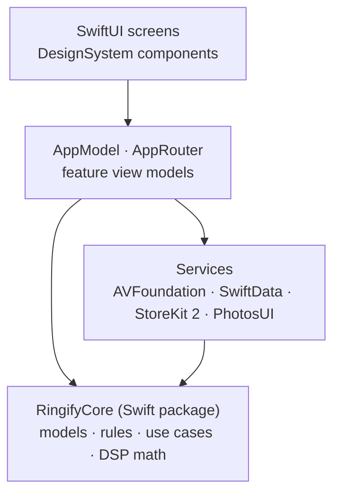

<div align="center">


# Ringify

**Turn any moment into your ringtone.**
An offline-first iPhone ringtone studio: import a video, a song or a voice memo, cut the perfect 1–29 second clip, shape the sound and set it as your ringtone. Everything runs on device.


<br>

&nbsp;
&nbsp;
&nbsp;


</div>

---

## Contents

- [Features](#features)
- [Screenshots](#screenshots)
- [Architecture](#architecture)
- [Tech stack](#tech-stack)
- [Project structure](#project-structure)
- [Getting started](#getting-started)
- [Testing and CI](#testing-and-ci)
- [Design](#design)
- [Privacy](#privacy)
- [Status](#status)

## Features

### Capture
- **Import from anywhere:** videos from Photos via the system picker (no full library access), audio and video from Files.
- **Voice recorder:** live input-level history, pause and resume, and markers dropped while recording that carry over to the editor.
- **Audio converter:** MP4 / MP3 to WAV or M4A, up to 512 MB and 30 minutes, without touching the source file.

### Edit
- **Waveform studio:** precise trim handles with 44 pt targets, pinch and slider zoom, undo and redo, loop playback.
- **Markers and smart segments:** jump to saved moments, or let Ringify suggest the strongest 15, 20 and 29 second sections.
- **Effects:** volume, fade in and out, 3-band EQ, high-pass and low-pass filters, mono or stereo, limiter and seamless loop crossfade.
- **Before/after comparison and analysis:** A/B the original against the processed sound and inspect the signal.
- **Personal presets:** save a sound and apply it to the next project in one tap.

### Deliver
- **Ringtone preview and export:** validated AAC M4A output with duration and size summary, shared to Files or any app.
- **Set as ringtone guide:** step-by-step flows for iOS 26+ and for the GarageBand method.
- **Library:** search, Favorites, Collections, sorting, list or grid layout, batch organisation and export history.

### Platform
- **Ringify Pro** with StoreKit 2: weekly, monthly, yearly and lifetime plans, plus extra project slots.
- **Light and Dark mode**, Dynamic Type, VoiceOver labels and actions, Reduce Motion support.
- **Turkish and English** localisation.
- **iOS 26 Liquid Glass** where available, with a native iOS 17 fallback.

## Screenshots

<table>
  <tr>
    <th>Import</th>
    <th>Record</th>
    <th>Convert</th>
    <th>Preview</th>
  </tr>
  <tr>
    <td></td>
    <td></td>
    <td></td>
    <td></td>
  </tr>
  <tr>
    <th>Export</th>
    <th>Set as ringtone</th>
    <th>Ringify Pro</th>
    <th>Settings</th>
  </tr>
  <tr>
    <td></td>
    <td></td>
    <td></td>
    <td></td>
  </tr>
</table>

### Dark mode

<p>
  &nbsp;
  &nbsp;
  &nbsp;
  &nbsp;
  
</p>

> Screenshots are unedited XCUITest captures from the iPhone Simulator (390 × 844 pt), taken by the CI pipeline on a real audio fixture.

## Architecture

Ringify separates platform code from product rules. The app target owns UI and system frameworks; the `RingifyCore` Swift package holds the domain logic and builds and tests on macOS without a simulator.



| Layer | Responsibility |
| --- | --- |
| **Screens / DesignSystem** | SwiftUI views, shared components (`RingifyPrimaryButton`, `RingifyRow`, outlined cards), semantic colors and tokens. |
| **App** | `AppModel` state, `AppRouter` navigation, dependency container. |
| **Services** | Media import and extraction, waveform, trim, effects rendering, AAC export, conversion, recording, playback, SwiftData persistence, purchases. |
| **RingifyCore** | Ringtone rules (1–29 s), editor history, gain envelopes, loop crossfade, segment suggestions, signal analysis, library models, Pro access policy. |

Swift 6 language mode with **complete strict concurrency** is enabled for every target.

## Tech stack

| Area | Technology |
| --- | --- |
| Language | Swift 6 |
| UI | SwiftUI, SF Symbols, Liquid Glass (iOS 26) |
| Audio | AVFoundation, AVAudioEngine, AVAssetExportSession |
| Persistence | SwiftData, sandboxed app directories |
| Purchases | StoreKit 2 with a local `.storekit` configuration |
| Project | XcodeGen (`ios/project.yml`) |
| Tests | XCTest (unit, integration, UI) |
| CI | GitHub Actions on macOS runners |
| Web preview | React, TypeScript, Vite, Vitest |

## Project structure

```text
.
├── ios/
│   ├── project.yml             # XcodeGen project definition
│   ├── Ringify/
│   │   ├── App/                # entry point, AppModel, navigation
│   │   ├── Screens/            # feature screens
│   │   ├── DesignSystem/       # theme, components, editor rules
│   │   ├── ViewModels/         # feature view models
│   │   ├── Services/           # AVFoundation, SwiftData, StoreKit
│   │   └── Resources/          # assets, localisation, StoreKit config
│   ├── RingifyTests/           # unit and integration tests
│   └── RingifyUITests/         # end-to-end UI flow and screenshots
├── packages/RingifyCore/       # platform-independent domain package
├── preview/                    # React interactive preview for Windows
├── shared/                     # product catalogue shared by app and preview
├── design/                     # design tokens and brand source
├── scripts/                    # CI and validation helpers
└── .github/workflows/          # manual macOS validation pipelines
```

## Getting started

### Requirements

- macOS with **Xcode 16** or newer (iOS 17 SDK minimum; iOS 26 SDK for Liquid Glass)
- [XcodeGen](https://github.com/yonaskolb/XcodeGen)

### Run the app

```bash
brew install xcodegen
cd ios
xcodegen generate
open Ringify.xcodeproj
```

Select the **Ringify** scheme and an iPhone simulator, then run. The scheme uses `Ringify.storekit`, so purchases work locally without App Store Connect.

### Core package

```bash
swift test --package-path packages/RingifyCore
```

### Web preview (optional)

A browser-based interactive preview for working on Windows. It is not a replacement for the native app.

```bash
cd preview
npm ci
npm run dev      # http://127.0.0.1:5173
npm test
```

## Testing and CI

| Suite | Scope |
| --- | --- |
| `RingifyCoreTests` | Ringtone rules, editor history, DSP math, segment suggestions, analysis parity fixtures |
| `RingifyTests` | Services with real audio (MP3, AAC, MP4 → WAV / M4A), SwiftData disk and migration, StoreKit test sessions, presentation and contrast checks |
| `RingifyUITests` | Full user journey from onboarding to export, capturing every screen in Light and Dark mode |

CI runs on demand through **Actions → Native validation (manual)**:

| Scope | What runs |
| --- | --- |
| `core` | Builds and tests `RingifyCore` |
| `ios` | Generates the project and runs the unit and integration tests |
| `ui` | Unit tests, Release build and the end-to-end UI flow, uploading 40 screenshots as an artifact |

Latest `ui` run: Release build passed, **135 / 135** unit tests and the UI flow passed.

## Design

Ringify follows the Apple Human Interface Guidelines with a restrained, monochrome look:

- System grouped backgrounds and semantic colors, so Light, Dark and Increase Contrast work without a custom palette.
- **Monochrome primary actions:** black in Light mode, white in Dark mode. Violet is reserved for small highlights such as links, selection, waveforms and the active tab.
- Primary actions sit in a fixed bottom bar; every control meets the 44 pt touch target.

The full design contract lives in [docs/NATIVE_APPLE_DESIGN.md](docs/NATIVE_APPLE_DESIGN.md).

## Privacy

- All audio processing happens on device; no account, no analytics, no tracking.
- Photos access goes through the system picker, so only the chosen video is shared with the app.
- A privacy manifest ships with the app (`PrivacyInfo.xcprivacy`).

## Status

Ringify is in active development and not yet on the App Store. The native app is verified on the iPhone Simulator; physical-device, VoiceOver and App Store / StoreKit sandbox acceptance are the next milestones.

---

<sub>© 2026 Ringify. All rights reserved.</sub>
